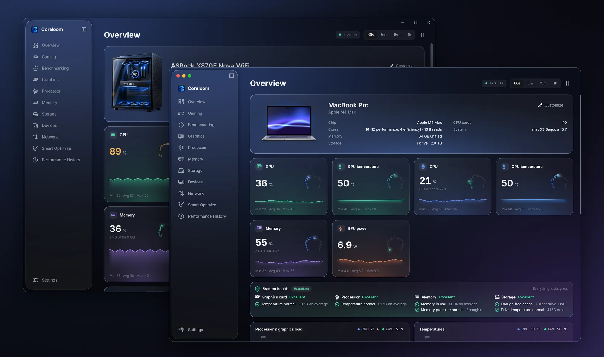
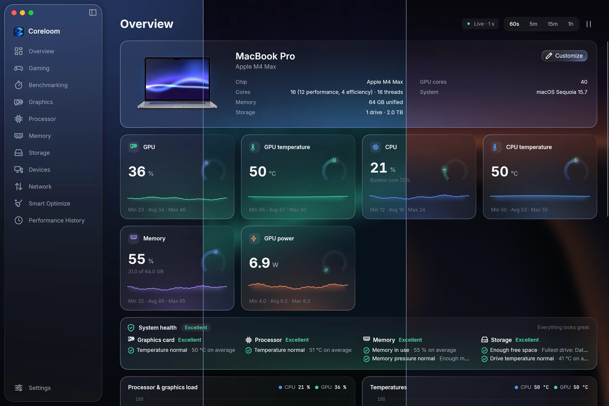
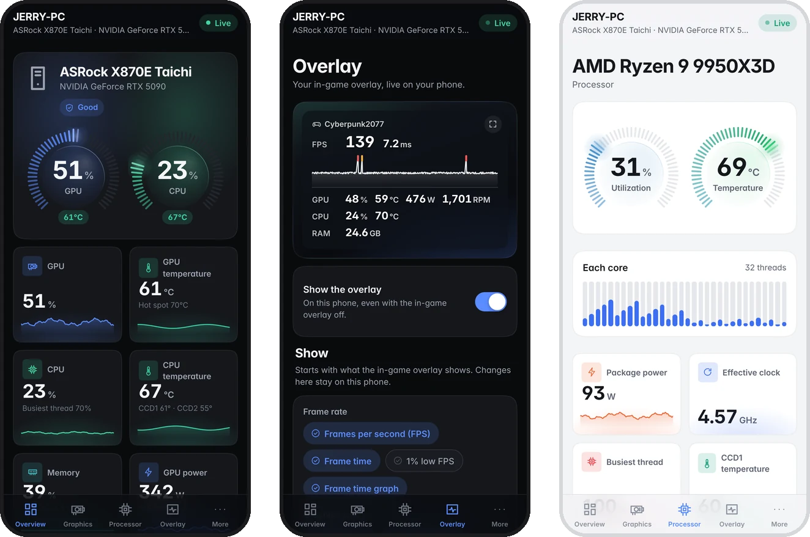

# Coreloom

<p align="center">
  
</p>

A native hardware monitor for **Windows 11 and macOS** with a calm, modern dashboard: live GPU, CPU, memory,
storage and network telemetry, animated charts with up to an hour of history, a gaming hub, benchmarks, smart
clean-up, threshold alerts, a tray or menu bar icon and verified in-app updates.

Coreloom only **reads** sensors. It never changes clocks, voltages, fan curves or firmware settings, never
installs drivers or services, and never sends your data to the internet. New in 1.8.2: your own background behind
frosted glass, a dark color, a gradient or a picture, with the sidebar and every card made of the same glass. And
since 1.7.0, your computer's readings live on your phone, over your own network
([Coreloom on your phone](#coreloom-on-your-phone)).

## Download

<p align="center">
  <a href="https://github.com/jerryubah/Coreloom/releases/latest/download/Coreloom-macOS-Apple-Silicon.dmg"></a>
  <a href="https://github.com/jerryubah/Coreloom/releases/latest/download/Coreloom-macOS-Intel.dmg"></a>
  <a href="https://github.com/jerryubah/Coreloom/releases/latest/download/Coreloom-Windows-Setup.exe"></a>
</p>

<p align="center">
  <a href="https://jerryubah.github.io/Coreloom/"><b>Website</b></a> ·
  <a href="../../releases/latest">All files and checksums</a> ·
  <a href="#install">How to install</a> ·
  <a href="CHANGELOG.md">What's new</a>
</p>

Each button downloads the newest version. Once installed, Coreloom keeps itself up to date: *Check for updates*
(the Coreloom menu on a Mac, *Settings › Updates* on Windows) installs a new version in place.

> **Project status:** Coreloom for Windows has been released since 1.0.0 and runs every day on Windows 11 with
> an NVIDIA GeForce RTX 5090 and an AMD Ryzen 9 9950X3D. **Coreloom for Mac** is new in 1.6.0: every build is
> built, packaged, opened page by page and photographed on GitHub's Apple silicon and Intel Macs, which are
> virtual machines without temperature, power or fan sensors, so readings from real Mac hardware are the part
> least tried so far. If a sensor reads wrong, please [open an issue](../../issues) with a diagnostic report
> attached (*Settings › Diagnostics › Export diagnostic report*, or [CoreloomDiag](#diagnostics-coreloomdiag) on
> Windows). **Coreloom on your phone** is new in 1.7.0 (its Overlay tab in 1.8.0): its pairing, encryption and
> pages are tested against the real server in a phone-sized browser and on GitHub's Windows and Mac machines, but
> not yet on a real iPhone or Android phone, or with a real game's frame rate on the phone. [docs/VERIFICATION.md](docs/VERIFICATION.md) lists what has and hasn't been verified.

---

## Features

<p align="center">
  
</p>

- **Design.** One background across the whole window, with the sidebar and every card made of frosted glass that
  shows a soft copy of what's behind it (1.8.2); smooth squircle corners on every card and control; cards with data glow
  in their own color, and their edge glows in that color under the pointer; temperatures shown like a thermometer (blue
  when cool through to red when hot); a near-black dark mode; tick-ring gauges; liquid toggles; quick search with live
  results (Ctrl+K); eased scrolling everywhere; and a dark-mode app icon, on Coreloom's shortcuts too.
- **Your background (1.8.2).** *Settings › Appearance › Background*: eight dark colors (or any color), eight dark
  gradients (Coreloom's own follows your accent color), six pictures drawn for Coreloom (Silk, Aurora, Nebula, Dunes,
  Bloom, Light trails) or a picture of your own, under a frosted layer with *Picture opacity* and *Frosted glass blur*
  sliders; or the desktop through the window (Mica on Windows 11, Translucent on a Mac).
- **Overview dashboard.** A header for your PC: motherboard, graphics card and key specs next to a rendered PC whose
  lighting color you choose (blue, purple, red, green, rainbow or your accent) and whose fans turn with your real fan
  speeds; or a render of your own build. Six summary cards (GPU utilization, GPU
  temperature, CPU utilization, CPU temperature, RAM, GPU power), each with a radial gauge, a sparkline,
  threshold colors and min/max/avg. Every gauge and usage ring uses one color scale: green when idle or cool, blue
  in the normal range, orange when heavy and red at the limit, gliding from one to the next as the value moves.
  Below them are large charts and memory, storage and network panels, all on one grid: drag a card to move it and
  drag its corner to resize it. *Customize* opens a card right on the Overview to show or hide the PC picture, pick
  its lighting, and hide and reorder cards; the layout is saved.
- **Gaming.** A tab with your installed games (Steam, Epic Games, GOG, Xbox, Ubisoft Connect, EA app, Battle.net,
  Riot) as cards or a grid of covers (a game without a picture on your PC gets one from its store or Steam
  automatically), with search, sorting and *Play*; **games added by hand** (*Add game*: pick the .exe, give it a name,
  a picture or the program's icon, and change or remove it later), which are recognised, monitored and limited like
  the rest; switches for hardware-accelerated GPU
  scheduling, the Ultimate Performance power plan, Game Mode, windowed-game optimizations, Game Bar background
  recording, the NVIDIA *Prefer maximum performance* mode, G-SYNC for fullscreen and windowed games, a 10 GB / 100 GB /
  unlimited NVIDIA shader cache and **intelligent CPU core scheduling**, each saying what it helps with and how to use
  it (or *Boost now* for all of them); core scheduling knows which cores suit games (the 3D V-Cache CCD of a multi-CCD
  Ryzen X3D such as the 9950X3D, or a hybrid processor's performance cores), shows where the game you're playing runs,
  checks AMD's chipset driver, Game Mode and the power plan it depends on, and keeps a game on chosen cores only after
  an A/B test in that game shows a clear gain and you keep it, never against AMD's own scheduling; a **frame limiter** that sets the NVIDIA driver's own frame limiter for all games or
  for one game on its own, automatically just under your refresh rate so G-SYNC/FreeSync stays engaged, with live FPS,
  1% low and pacing of the game you're playing; **adaptive frame pacing** (off until you turn it on), which measures
  each game's real frame times while you play and sets the game's own limit to a frame rate it holds with steady 1%
  lows, a step at a time, under your refresh rate and in whole rendered frames with frame generation; and shader-cache
  care (cache sizes, a notice when a new driver resets them).
- **Benchmarking.** A CPU benchmark (eight tests of everyday and demanding work — compression, text processing,
  cryptography, navigation, ray tracing, machine learning, a photo filter and physics — on one core and on every
  thread, for a single-core and a multi-core score) and a GPU benchmark (two graphics tests and three compute tests on
  Coreloom's own off-screen Direct3D 11 device, for a GPU score with graphics and compute parts). The cards show your
  latest run; every result is saved, with a **Best** badge on your highest CPU and GPU scores in the list; open one for each test, the clocks, temperatures, power and
  voltages during the run, and what they say about overclocking (Precision Boost Overdrive, a raised graphics power
  limit, clocks past the rated maximum). A **stress test** loads the processor, the graphics card or both for up to an
  hour, checks every answer for calculation errors and passes at 97 % stability, like 3DMark's. Scores are Coreloom's
  own scale (GPU scores land in the hundreds of thousands on high-end cards, like Geekbench's GPU scores); nothing is
  overclocked or changed.
- **In-game overlay.** FPS, frame time and 1% lows with a smooth frame-time graph and GPU, CPU and RAM readings on top
  of your games, measured from Windows' graphics events (nothing is injected into games, and Coreloom gives way to the
  game while it runs); while the frame limiter limits the game, its limit is a dashed line on the graph. Turned on
  from the Graphics page or with a hotkey (End by default); choose what it shows (each line in its own size), where
  (nine places, fine-tuned X/Y, or a place per game), its size (Compact, Standard, Expanded or your own scale, following
  your screen's resolution), and its text, colors, opacity and corners. *Move on screen* (or Shift + the hotkey) lets
  you drag it in the game and resize it by its corner; where you drop it is kept.
- **Health cards** on the Overview, Graphics, Processor, Memory and Storage pages: Excellent, Good or Needs attention,
  from the last minute of temperatures, clock slowdowns, fans, memory and commit charge, free space and drive wear,
  with the reasons.
- **Smart Optimize.** One Smart Scan finds junk files (temporary files, browser and shader caches, crash reports,
  Windows Update leftovers, the Recycle Bin), checks Microsoft Defender's protection and threats, memory use and
  startup apps; one click then cleans up, removes threats, frees memory and refreshes the network cache. Each part
  has its own card too: pick what to clean, run a quick scan or update definitions, free up RAM (with every process
  listed: memory before and after and what was reclaimed, or why it was skipped or failed), turn startup apps off and
  on, flush DNS or optimize drives.
- **Devices.** A page with your Bluetooth devices as cards (type icon, connected indicator, battery where reported,
  Connect and Disconnect, which also brings back headphones that switched to your phone) and the devices plugged in by
  USB or display cable, grouped by type on the same grid as the Bluetooth cards, with *Eject* for drives and driver problems flagged. Bluetooth can be turned
  on and off there, and *Pair a new device* opens Windows' Bluetooth settings. Any Bluetooth device can be renamed
  (the pencil on its card, or right-click); the name is kept in Coreloom, and Windows keeps the device's own.
- **Drive speed test** on the Storage page: sequential and random read and write speeds (like CrystalDiskMark) on a
  temporary file that is deleted afterwards.
- **Internet speed test** on the Network page: download, upload, ping and jitter against Cloudflare's speed test
  servers, with a live gauge.
- **Detail pages** for the GPU, CPU, memory, storage and network:
  - per-thread CPU graphs and a per-core table, boost and performance-limit (throttling) readings, and the
    processor's CPUID details (instruction sets, boost, preferred cores);
  - on AMD Ryzen: architecture and codename, PPT, TDC, EDC, SoC power and voltage, fabric and memory clocks where the
    processor reports them (and why not where it doesn't), AMD's stock power limit, whether PBO looks on, and
    Curve Optimizer, Eco mode and manual tuning shown as unavailable with where to change them (read-only);
  - top processes;
  - SMBIOS memory modules;
  - per-disk activity, temperature and volumes;
  - per-adapter traffic.
- **Vendor marks.** The CPU and GPU names carry a vendor mark. Coreloom shows the official NVIDIA, AMD or Intel
  logo if you add the files (see [assets/vendors/README.md](assets/vendors/README.md)) and a plain-text badge
  until then.
- **Performance History.** Compare up to six metrics on stacked, time-aligned charts with synchronized hover.
  Choose a 60 s, 5 min, 15 min or 1 h window and export to CSV.
- **Honest data.** Every value is labelled *measured* or *derived*, along with its source (NVML, Windows
  performance counters, LibreHardwareMonitor…). Missing sensors say why they're missing. Nothing is
  estimated or faked.
- **Charts.**
  - Smooth GPU-composited rendering.
  - M4 min/max downsampling, so peaks never disappear.
  - Monotone curves that don't overshoot.
  - Pause/freeze and a reduced-motion mode.
- **Desktop integration.**
  - An animated 16:9 startup splash (flowing light, a loading bar that moves with each startup step) that fades
    into the dashboard as soon as the window has painted (skipped when Coreloom starts in the tray; follows
    reduced-motion settings).
  - Dark and light themes with a custom accent color.
  - Mica, Snap Layouts and a collapsible sidebar.
  - A tray icon with a live tooltip, start with Windows (elevated through Task Scheduler, so no prompt at
    sign-in), minimize/close to tray, and single instance.
- **Alerts.** Per-metric rules with a sustain time, hysteresis and a cooldown, delivered as Windows
  notifications.
- **Automatic updates.** New versions come from GitHub Releases with no token needed.
  - Installed and portable copies alike download updates in the background and install them the next time
    Coreloom starts, while the PC is idle, or right away with *Install update*, which closes Coreloom, installs
    the new version over the old one and opens it again. *Settings → Updates* has *Check for updates*, the
    on/off switch and a short *What's new* summary of each release.
  - A badge in the sidebar and a notification say when a new version is available or ready.
  - Downloads can resume and are SHA-256 verified before anything runs. Files are replaced only after Coreloom
    has exited, by the installer or (portable copies) by the new version, and a failed update is rolled back.
- **Low overhead.** Coreloom polls on a dedicated thread and does no UI work while minimized or covered by a game.
  While a game is in front it reads sensors less often (every 2 s by default; 1 s, 2 s or 5 s), at low priority, and
  gives the game priority; the refresh interval otherwise is yours to choose (0.25 s to 5 s). *Settings › Diagnostics*
  shows its own CPU and memory use, and what each part costs: sensor reading, the window, the overlay's graph and
  frame counter.
- **Logs.** *Settings › Logs* (or *Open logs* on the memory card) shows Coreloom's log with timestamps, search, a
  level and category filter, and copy and open-folder buttons.

### The product film

<p align="center">
  
</p>

Made with Coreloom 1.4.5 on Windows, before the frosted-glass design and the Mac app.

## Coreloom for Mac

Coreloom for Mac is the same app as on Windows, built for macOS 14 Sonoma and later on Apple silicon and Intel:
a native Mac window (an Avalonia interface on macOS's own AppKit and Metal), the same view models and engine, and
macOS's own sources for every reading. What changes on a Mac:

- **Readings.** Apple silicon's performance and efficiency cores and their clocks, the GPU's load, renderer and
  tiler, the Neural Engine's and the whole Mac's power (IOReport), temperatures and fans (the SMC and the HID
  temperature sensors), memory pressure with app, wired and compressed memory and swap, batteries, drives and
  network. Memory is shown in binary units like Activity Monitor, storage in decimal units like Finder.
- **A picture of your Mac** in the Overview header (MacBook, iMac, Mac mini, Mac Studio or Mac Pro), lit in the
  color you choose. A MacBook or iMac shows your own desktop picture on its screen (*Customize › Show my desktop
  picture on the screen*), and a MacBook's keyboard catches the screen's light. No Apple logo is drawn.
- **Menu bar and Dock.** A menu bar item with live readings, Pause, Settings and Quit; closing the window keeps
  Coreloom in the menu bar (and, if you like, out of the Dock); *Open at login* is a standard login item.
  *Settings › Menu bar* also puts the readings you pick in the menu bar itself, each as its own item (processor and
  graphics load, memory, temperatures, the fastest fan, network, storage, battery, power), with its name and a slim
  bar if you like. A full
  app menu with the usual shortcuts (⌘, for Settings, ⌘1–⌘9 for the pages, ⌃⌘S for the sidebar) and a native
  About panel.
- **Gaming.** Your Steam, Epic Games and Applications-folder games with Play, plus the switches that matter on a
  Mac: Game Mode (macOS turns it on for full-screen games), full power on the charger (Low Power Mode off, High
  Power Mode on where the Mac has it), keeping the Mac awake while a game runs, and Apple's Metal Performance HUD.
  Metal's shader caches are listed, and a macOS update that resets them is pointed out.
- **The in-game overlay** shows Coreloom's readings over full-screen apps and games (⌥⌘O by default; set it up on
  the Graphics page). Nothing is added to games, so it shows Coreloom's readings rather than a frame rate: Apple's
  Metal HUD shows that.
- **Benchmarks** on Metal: the same CPU benchmark, the GPU benchmark's graphics and compute tests on Metal, and
  the stress test.
- **Smart Optimize** for macOS: app caches, logs, temporary files, Xcode's build files, shader caches, old
  installers in Downloads and the Trash; XProtect, Gatekeeper, System Integrity Protection, FileVault and the
  firewall; freeing inactive memory (macOS's `purge`); login items (launch agents); and refreshing the DNS cache.
- **Devices.** Bluetooth accessories with their batteries (Apple's own report them), names you give them,
  connect and disconnect, the Bluetooth switch, and USB, Thunderbolt and display devices with *Eject* for drives. macOS asks once whether
  Coreloom may use Bluetooth, when you click *Allow Bluetooth*.
- **Updates.** The same verified updates: the new version is downloaded, checked against the release's
  SHA-256 checksums and its code signature, and swapped in after Coreloom quits (the old copy is put back if
  anything fails).
- **No administrator rights.** Coreloom for Mac runs as you, with no helper, kernel extension or driver. The few
  changes that need your password (freeing memory, the DNS cache, the power mode) ask through macOS's own
  dialog, and only when you click them.

## Coreloom on your phone

<p align="center">
  
</p>

New in 1.7.0: your PC's or Mac's readings live on your phone, over your own network. Turn it on in
*Settings › Connect*, point your phone's camera at the QR code there, and Coreloom opens in the phone's browser,
already paired. No app store, no account, no cloud.

- **Pair once.** Scan the QR code, or type the address shown in *Settings › Connect* into the phone's browser and
  enter the six-digit pairing code. *Add to Home Screen* (Share › Add to Home Screen on an iPhone, ⋮ › Add to Home
  screen on Android) keeps an icon that opens Coreloom full screen whenever you're on the same network.
- **The same dashboard.** An Overview with the GPU and CPU gauges, the health check and the summary cards, then
  Graphics, Processor (every core), Overlay and More (memory, drives, network, battery and your computer's specs),
  with two-minute live charts, in Coreloom's dark and light themes.
- **Your in-game overlay on your phone** (1.8.0). The Overlay tab shows the game in front, its FPS and frame-time
  graph, and the readings the in-game overlay shows, even when that's turned off; choose more readings there (they
  stay on the phone), or go full screen to keep it beside your monitor with the screen on. A Mac can't measure
  another app's frame rate, so there it shows readings only.
- **Updates.** When your computer has a newer Coreloom, the phone says so in a bar at the top.
- **Paired phones** are listed in *Settings › Connect* with when each last connected; *Remove* unpairs one, and a
  phone can forget your computer from its own *More* page.
- **Private.** Connect is off until you turn it on, answers only on private networks such as your home Wi-Fi, and
  only phones you've paired. Pairing is a one-time key exchange (P-256), every reading is encrypted
  (AES-256-GCM) between your computer and your phone, and nothing goes through the internet or any server. Phones
  can only look: nothing on your computer can be changed from a phone. Pairing is open only while
  *Settings › Connect* is showing, and each code works once.
- **On Windows,** turning Connect on adds one firewall rule, *Coreloom Connect*, for private and domain networks
  (never public ones), and turning it off removes it. If your Wi-Fi is set to *Public*, Settings › Connect says so.
  **On a Mac** nothing needs allowing, unless the macOS firewall is on, in which case macOS may ask once.

How it works is in [src/Coreloom.Phone/README.md](src/Coreloom.Phone/README.md).

## What Coreloom reads, and from where

| Area | Source | Administrator needed? |
|---|---|---|
| NVIDIA GPU: utilization, temperature, clocks, VRAM, power and limit, fan %, P-state, clock-limit reasons, encoder/decoder, PCIe | **NVML** (ships with the NVIDIA driver) | No |
| GPU hot spot, memory junction, fan RPM, voltage (not in NVML) | LibreHardwareMonitor (NvAPI) | No |
| AMD / Intel GPUs | LibreHardwareMonitor | Usually no |
| CPU total and per-thread utilization, effective clock, boost, performance limit | Windows performance counters (PDH) | No |
| CPU family, model, instruction sets, boost and preferred-core support | The CPUID instruction | No |
| CPU temperatures (Tctl/Tdie, CCDs), package power, per-core clocks | LibreHardwareMonitor via the **PawnIO** driver | **Yes**, plus PawnIO installed |
| AMD Ryzen PPT, TDC, EDC, SoC power and voltage, fabric/memory clocks, SoC and I/O die temperatures (where LibreHardwareMonitor knows the processor's SMU table: some Ryzen 2000 APU, 3000, 5000 and 7000/9000 desktop firmware) | LibreHardwareMonitor via PawnIO (SMU power table, SVI2 telemetry) | **Yes**, plus PawnIO installed |
| Motherboard fans, voltages, temperatures (Super I/O) | LibreHardwareMonitor via PawnIO | **Yes**, plus PawnIO installed |
| Memory usage, commit, modules | Windows APIs + SMBIOS | No |
| Disk activity, capacity, volumes, NVMe temperature | PDH + storage IOCTLs (query-only handles) | No; some drives report temperature only to administrators |
| Network throughput | Windows network statistics | No |
| Bluetooth devices, adapter state, battery levels | Windows Bluetooth APIs (WinRT) and the device tree | No |
| Wired devices (USB, displays, Thunderbolt) | Plug and Play device tree (configuration manager) | No |
| Installed games and their pictures | The launchers' own files (Steam `libraryfolders.vdf`, app manifests and library picture cache; Epic manifests; GOG and Xbox game folders) and Windows' installed-apps list; for games without a picture, Epic's catalog pictures or Steam's public store | No |
| GPU scheduling, power plan, Game Mode, windowed-game and Game Bar settings | Windows: the graphics kernel (D3DKMT), the registry values Windows Settings uses, `powercfg` | Changing GPU scheduling: **yes** |
| NVIDIA frame limit, shader cache size, power management mode, G-SYNC, driver version | **NVAPI** driver settings (the store the NVIDIA Control Panel uses) and display info | Changing them: **yes** |

On a Mac:

| Area | Source | Administrator needed? |
|---|---|---|
| CPU load per core | The kernel's per-processor tick counters (`host_processor_info`, as Activity Monitor) | No |
| Clocks and power of the CPU clusters, GPU and Neural Engine; system power (Apple silicon) | **IOReport** (the counters `powermetrics` reads) | No |
| Temperatures, fans, battery and adapter power | The **SMC** (System Management Controller) and the HID temperature sensors | No |
| GPU memory, renderer and tiler load, Metal device and its cores | The I/O registry (`IOAccelerator`) and **Metal** | No |
| Memory pressure, app, wired and compressed memory, swap | Mach `host_statistics64`, `vm.swapusage`, the memory-pressure level | No |
| Drives, volumes and activity | IOKit (`IOBlockStorageDriver` statistics), `statfs` and the volumes' own properties | No (macOS doesn't share an SSD's wear with apps) |
| Network throughput | The kernel's 64-bit interface counters, named as System Settings names them | No |
| Bluetooth devices and batteries; USB, Thunderbolt and displays | IOBluetooth, the I/O registry and System Information (`system_profiler`) | No (macOS asks once for Bluetooth) |
| Installed games and their pictures | Steam's and Epic's library files, apps in the Applications folder's Games category, and (for games without a picture) Steam's public store | No |
| Game Mode, Low/High Power Mode, Metal HUD | macOS's own settings (`pmset`, `defaults`) | Changing the power mode: **your password**, asked by macOS |
| The desktop picture on the Overview's MacBook | `NSWorkspace` (which picture is on the main screen), converted once to a PNG with macOS's `sips` and kept in Coreloom's own folder; never sent anywhere. A picture in Desktop, Documents, Downloads, iCloud Drive or another app's folder is read only after you choose *Show it* in Customize | No (macOS may ask once for those folders) |

**About PawnIO.** Reading CPU temperature and motherboard sensors on modern Windows needs a kernel driver.
LibreHardwareMonitor uses [PawnIO](https://pawnio.eu), a signed, open-source driver. Coreloom **never installs
it**. If you want those sensors:

1. Install PawnIO yourself from its website.
2. Restart Coreloom. It always runs as administrator, so nothing else is needed.

Without it, everything else still works and the affected cards explain what's missing.

## Requirements

- **Windows:** Windows 11 x64, version 23H2 or later (the versions .NET 10 supports). Windows 10 may work, but it
  isn't a supported or tested target. Mica needs Windows 11 22H2 or later.
- **Mac:** macOS 14 Sonoma or later (the versions .NET 10 supports: 14 Sonoma, 15 Sequoia and 26 Tahoe), on Apple
  silicon (M1 and later) or an Intel processor. There is a download for each.
- Nothing else: every download is self-contained and includes the .NET runtime.
- To build from source: the [.NET 10 SDK](https://dotnet.microsoft.com/download). Inno Setup 6 is
  optional and only needed to build the Windows installer.

## Install

### Mac

1. Download the disk image for your Mac: [Apple silicon](https://github.com/jerryubah/Coreloom/releases/latest/download/Coreloom-macOS-Apple-Silicon.dmg)
   (M1 and later) or [Intel](https://github.com/jerryubah/Coreloom/releases/latest/download/Coreloom-macOS-Intel.dmg).
   Not sure which? *Apple menu › About This Mac* says *Chip: Apple M…* on Apple silicon and *Processor: … Intel* on Intel.
2. Open it and drag **Coreloom** onto **Applications**.
3. Open Coreloom from Applications. Coreloom is open source and isn't sold through the App Store or signed with a
   paid Apple developer certificate, so the first time macOS says it *could not verify* Coreloom: click *Done*,
   open **System Settings › Privacy & Security**, scroll down and click **Open Anyway** (then *Open*). macOS
   remembers it; you won't be asked again, and updates installed from inside Coreloom don't ask either.
   (If you prefer the Terminal: `xattr -dr com.apple.quarantine /Applications/Coreloom.app` does the same.)

Coreloom then sits in the menu bar and the Dock. *Coreloom › Check for Updates…* (or the menu bar item) installs a
new version right away; otherwise updates download in the background and install the next time Coreloom starts
or while the Mac is idle.

To verify a download, compare `shasum -a 256 Coreloom-*.dmg` with `SHA256SUMS.txt` from the same release.

**Uninstall.** Quit Coreloom (⌘Q) and move it from Applications to the Trash. Turning off *Open at login* first
removes its login item; otherwise remove it in *System Settings › General › Login Items*. Your settings are in
`~/Library/Application Support/Coreloom` and the logs in `~/Library/Logs/Coreloom`; delete them too for a clean
removal.

### Windows

Download from the [Releases](../../releases) page:

- **`Coreloom-x.y.z-win-x64-Setup.exe`** (recommended).
  - Installs per-user to `%LOCALAPPDATA%\Programs\Coreloom` with no administrator prompt (Coreloom itself
    asks for administrator approval each time you start it by hand; see below).
  - Adds a Start menu entry.
  - Updates in place from inside Coreloom.
- **`Coreloom-x.y.z-win-x64-Portable.zip`**: unzip anywhere and run `Coreloom.exe`. Settings and logs stay in a
  `Data` folder next to it. Updates in place from inside Coreloom too (the `Data` folder is kept).

To verify a download, run the following and compare the result with `SHA256SUMS.txt` from the same
release:

```powershell
Get-FileHash .\Coreloom-x.y.z-win-x64-Setup.exe -Algorithm SHA256
```

**Uninstall.** Use *Settings → Apps → Installed apps → Coreloom → Uninstall*. This removes the program, the
logon entry, downloaded updates and logs. Your settings in `%APPDATA%\Coreloom` are kept; delete that folder
too for a clean removal. If you enabled *Start with Windows*, the uninstaller also removes the
*Coreloom startup* scheduled task (this asks for administrator approval once).

**Administrator rights.** Coreloom always runs as administrator: Windows shows its normal approval prompt each
time you start it by hand. *Settings → Desktop → Start with Windows* registers a Task Scheduler task with the
highest privileges instead of a Run entry, so it starts at sign-in **without** a prompt. Running as
administrator is what lets the PawnIO driver expose CPU temperature, package power and motherboard sensors;
Coreloom still only reads sensors and never writes to hardware.

**Upgrading from Vigil.** Coreloom is Vigil under a new name. The first start copies your `settings.json` from
`%APPDATA%\Vigil` (the old folder is left alone). Uninstall Vigil separately if you installed it, and turn on
*Start with Windows* again in Coreloom if you had it on.

## Build from source

On Windows:

```powershell
git clone https://github.com/jerryubah/Coreloom.git
cd Coreloom
./build/build.ps1                     # restore, build (Debug), run unit tests
dotnet run --project src/Coreloom.App    # start the app
```

More build commands:

```powershell
./build/build.ps1 -Configuration Release -Publish        # self-contained build in artifacts/publish/win-x64
./build/build.ps1 -Version 1.0.0 -Package                # + installer, portable zip, SHA256SUMS.txt in artifacts/release
./build/build.ps1 -NoLhm                                 # build without LibreHardwareMonitor (NVML + Windows sensors only)
```

You can also open `Coreloom.sln` in Visual Studio 2026 (version 18.0 or later; earlier versions don't support
the .NET 10 SDK) or a current JetBrains Rider, then run **Coreloom.App**.

To enable update checks in your own builds, pass `-Repository owner/name` (CI does this automatically from
the GitHub repository). Without it, update checks are disabled.

On a Mac (Apple silicon or Intel, with the .NET 10 SDK):

```bash
dotnet run --project src/Coreloom.Mac                                  # start the Mac app from source
dotnet test tests/Coreloom.Hardware.Mac.Tests                         # the macOS back-end's tests (reads this Mac)
bash build/mac/bundle.sh --arch arm64 --version 1.6.0                 # Coreloom.app, the update zip and the disk image in artifacts/mac
bash build/mac/verify-app.sh arm64 artifacts/mac-verify               # package, check, install, open every page and photograph it
```

`Coreloom.Mac.sln` holds the Mac app, its back-end and the shared projects. `--repository owner/name` (bundle.sh)
turns on update checks, like `-Repository` on Windows. `tools/Coreloom.MacShots` draws every Mac page with sample
data on any system (`dotnet run --project tools/Coreloom.MacShots -- out`).

## Diagnostics: CoreloomDiag

`CoreloomDiag.exe` ships next to `Coreloom.exe`. It runs the same sensor engine headless and writes a Markdown
report covering:

- detected hardware and capabilities;
- every metric with its source and provenance;
- unavailable sensors and the reason for each;
- per-provider timing;
- Coreloom's own CPU and memory overhead.

```powershell
CoreloomDiag.exe --samples 30 --interval 1000 --compare --out coreloom-report.md
```

`--compare` samples `nvidia-smi` side by side with NVML and reports the differences. `--lhm-report` appends
LibreHardwareMonitor's own report. See [docs/TESTING-ON-YOUR-PC.md](docs/TESTING-ON-YOUR-PC.md).

## Privacy and safety

- **Hands off the hardware.** No writes to hardware or the BIOS, no driver installs, and no overclocking or
  fan-control features. Monitoring is read-only, and so is the AMD processor card: power limits, PBO and Curve
  Optimizer are shown, never changed.
- **The Gaming page changes settings only when you flip a switch.** Each switch sets one documented Windows setting
  (the registry values and `powercfg` commands Windows' own Settings use) or one NVIDIA driver setting (as the NVIDIA
  Control Panel does), shows its state and can be turned off again. Adaptive frame pacing, once you turn it on, sets
  and adjusts each game's own driver limit as you play (never a limit you set yourself), writes every change to the
  log, and removes its limits when you turn it off. Intelligent CPU core scheduling, once on, only reads AMD's 3D
  V-Cache driver and its preferences (it never changes them or restarts its service) and changes a game's cores only
  for a test you start or a profile you kept, the way Task Manager's *Set affinity* does; turning it off or closing
  Coreloom gives those games Windows' choice back. **Nothing is injected into games**: frame rates
  come from Windows' graphics events, the frame limiter is the driver's own limiter, and games start through their own
  launchers as you, not as administrator.
- **The Devices page changes something only when you click.** Connect, Disconnect, the Bluetooth switch and Eject do
  what Windows' own buttons do; nothing is unpaired or reconfigured.
- **Smart Optimize changes only what you ask it to.** It deletes files only inside known junk folders (never through
  links, never files younger than a day in temp folders, never files in use), turns startup apps off with the same
  switch Task Manager uses (turn them back on any time), and uses Windows' own tools for everything else: Microsoft
  Defender for scans and threats, the shell for the Recycle Bin, defrag.exe for drives. Freeing memory asks Windows
  to trim other apps' working sets (they page back in as needed); it skips the app in front, Coreloom and the Windows
  processes the desktop needs, and never ends a process.
- **No telemetry.** Coreloom makes network requests only for the update check to `api.github.com` and the update
  download from GitHub (both can be turned off in *Settings → Updates*), to `speed.cloudflare.com` when you start
  an internet speed test, and, for games that have no picture on your PC, to fetch one: Epic's picture servers
  (`cdn1.epicgames.com` and the links in the Epic launcher's catalog) and Steam's public store (a search on
  `store.steampowered.com` with the game's name, the game's pictures from `api.steampowered.com`, and the picture
  servers `shared.akamai.steamstatic.com` and `cdn.cloudflare.steamstatic.com`). Pictures are kept on your PC; a game
  nothing is found for is looked up again after a week. No hardware data is included.
- **Coreloom Connect stays on your network.** Only when you turn it on in *Settings › Connect*, Coreloom answers
  phones on your own network (port 47101, private addresses only) and shows its readings to the phones you've
  paired, encrypted. Nothing is sent to the internet, and a phone can't change anything on your computer.
- **Always elevated on Windows, never on a Mac.** On Windows Coreloom runs as administrator so the sensor driver can
  be read and Smart Optimize can clean system folders, but it never installs drivers or services and can't be
  controlled from anywhere else (Coreloom Connect only lets paired phones look). On a Mac it runs as you; the few changes that need your password ask for it through macOS's
  own dialog when you click them.
- **On a Mac, the same rules.** The Gaming page's switches set macOS's own settings (`pmset`, `defaults`) and turn
  off again; Smart Optimize deletes only inside your own Library's caches and logs (and what you tick) and empties
  the Trash through Finder; login items are switched with `launchctl`, as System Settings does. Network requests
  are the same as on Windows: GitHub for updates, Cloudflare for a speed test you start, and Steam's and Epic's
  picture servers for games without a picture.
- **Alert thresholds are reminders, not safety limits.** Check your hardware vendor's specifications;
  modern CPUs and GPUs protect themselves by throttling.

## Repository layout

```
src/
  Coreloom.Core/          platform-neutral engine: metrics, history, downsampling, alerts, settings, formatting, updater
  Coreloom.Hardware/      Windows providers: NVML, PDH, storage, network, SMBIOS, processes, LibreHardwareMonitor adapter
  Coreloom.Hardware.Mac/  macOS providers: IOReport, SMC, HID sensors, Mach statistics, IOKit storage, Metal benchmark
  Coreloom.ViewModels/    MVVM presentation layer shared by both apps (no UI types; unit-tested)
  Coreloom.App/           Windows app (WPF): theme, chart controls, pages, tray, startup, single instance
  Coreloom.Mac/           Mac app (Avalonia): the same pages, menu bar item, menus, in-game overlay, updater
  Coreloom.Phone/         the phone app (Coreloom Connect), served by Coreloom to paired phones on your network
  Coreloom.Diagnostics/   CoreloomDiag command-line diagnostic tool
tests/                 xUnit v3 tests for Core, Hardware (Windows and Mac) and ViewModels
tools/                 PageShots (Windows) and MacShots (Mac): every page drawn with sample data; ConnectDemo:
                       Coreloom Connect with sample readings, to try the phone app
installer/Coreloom.iss    Inno Setup script
build/                 build.ps1 (Windows), mac/bundle.sh and mac/verify-app.sh (Mac), release notes, checks;
                       backdrops/ draws the suggested background pictures; site/ and readme/ make the pictures of the app
assets/                icons, the suggested background pictures (backdrops/), device pictures, README pictures
site/                  the download page (GitHub Pages)
docs/                  architecture, testing, releasing, troubleshooting, verification report
```

See [docs/ARCHITECTURE.md](docs/ARCHITECTURE.md) for the design.

## Contributing

See [CONTRIBUTING.md](CONTRIBUTING.md). Bug reports with a CoreloomDiag report attached are very welcome.

## License

[MIT](LICENSE) © 2026 Jerry Ubah. Third-party components and their licenses are listed in
[THIRD-PARTY-NOTICES.md](THIRD-PARTY-NOTICES.md).

NVIDIA, GeForce and RTX are trademarks of NVIDIA Corporation. AMD, Ryzen and Radeon are trademarks of
Advanced Micro Devices, Inc. Intel is a trademark of Intel Corporation. Apple, Mac, macOS, Metal and Apple
silicon are trademarks of Apple Inc. Windows is a trademark of Microsoft Corporation. Coreloom is not affiliated
with or endorsed by these companies, and it does not bundle their logos.
